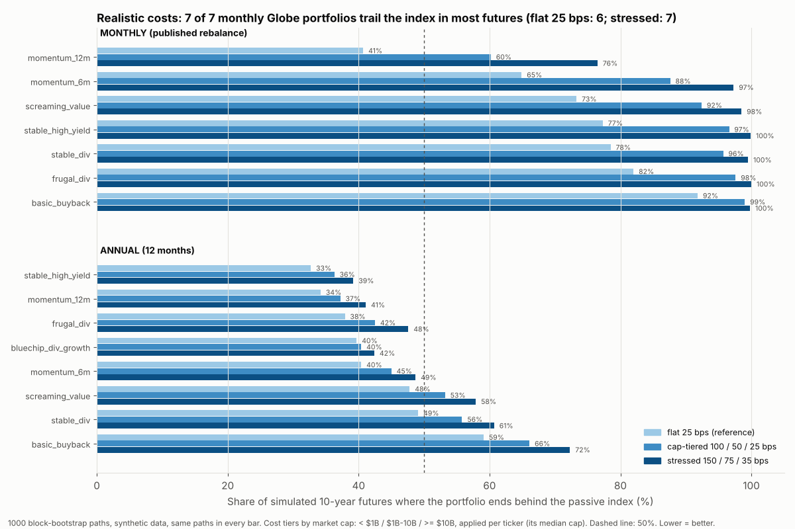
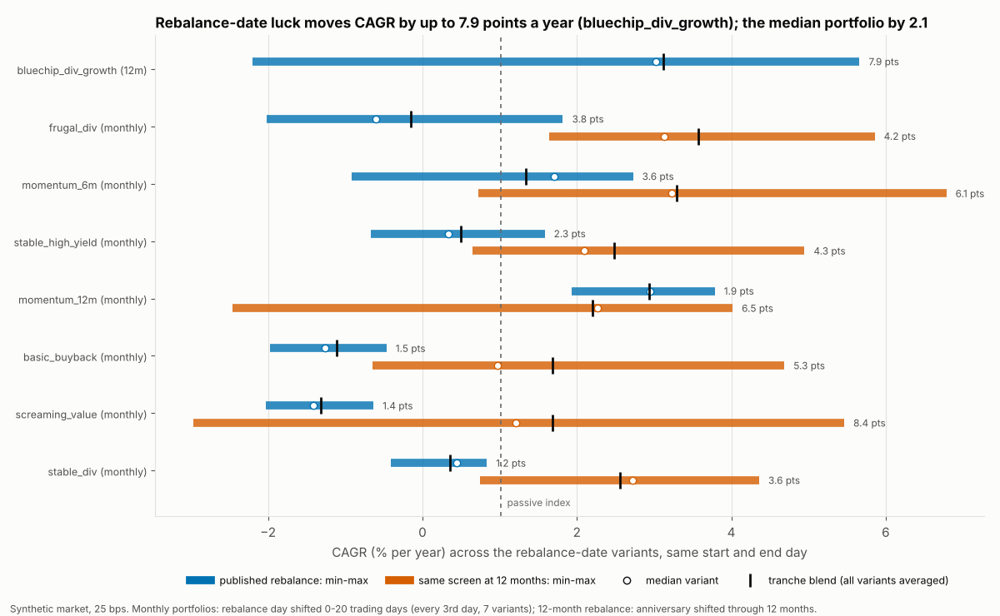

# Phase 1.5 diagnostics: what realistic costs, rebalance-date luck and one suspicious number change

*Script: `research/diagnostics.py` (about 14 minutes in all: part 1 ~9, part 2 ~3, part 3 ~1; seed 20241, 1000 block-bootstrap paths where Monte Carlo is used). Tables: `research/diagnostics/*.csv` (regenerated, not tracked in git).*

**Read this first.** Everything here runs on the **synthetic market** (250 generated stocks, 25 years, a cap-weighted total-return index). It tests
the machinery and the arithmetic of trading costs and timing, not the real-world edge of any screen. A screen that beats or trails the index here
says nothing about what it does on real data; the *size of the cost drag* and the *size of the timing spread* are the transferable lessons.

## 1. Realistic costs: which monthly Globe portfolios survive real trading?

The all-portfolio Monte Carlo (same seed, same 1000 paths, same 25 portfolios) re-run with trading cost depending on company size:
**tiered** = 100 bps below $1B market cap, 50 bps from $1B, 25 bps from $10B; **stressed** = 150 / 75 / 35 bps. The reference is the original flat 25 bps.
Of the 250 names, 63 are under $1B, 119 between $1B and $10B and 68 above $10B
(by each name's median market cap over the history). Table: 10-year horizon; CAGR is the median over futures; P(trail) = share of futures
ending behind the index; "extra drag" = median CAGR at flat 25 bps minus median CAGR under the model.

| Portfolio | CAGR flat | CAGR tiered | CAGR stressed | P(trail) flat | P(trail) tiered | P(trail) stressed | Extra drag tiered / stressed (pts/yr) | Flips to trailing |
|---|---:|---:|---:|---:|---:|---:|---:|---:|
| stable_high_yield (annual) | 3.0% | 2.5% | 2.1% | 33% | 36% | 39% | 0.48 / 0.91 |  |
| magic_formula | 2.4% | 2.0% | 1.7% | 33% | 37% | 42% | 0.32 / 0.63 |  |
| momentum_12m (annual) | 2.8% | 2.3% | 1.8% | 34% | 37% | 41% | 0.53 / 1.00 |  |
| frugal_dividend (annual) | 2.0% | 1.6% | 1.1% | 38% | 42% | 48% | 0.48 / 0.91 |  |
| momentum_12_1 | 2.4% | 1.9% | 1.5% | 38% | 42% | 45% | 0.49 / 0.93 |  |
| bluechip_dividend_growth | 2.1% | 2.0% | 1.8% | 40% | 40% | 42% | 0.08 / 0.29 |  |
| momentum_6m (annual) | 1.9% | 1.3% | 0.8% | 40% | 45% | 49% | 0.59 / 1.09 |  |
| momentum_12m (monthly) | 2.2% | -0.3% | -2.4% | 41% | 60% | 76% | 2.45 / 4.58 | flips (tiered) |
| low_vol_dividend | 1.4% | 1.2% | 1.0% | 42% | 44% | 48% | 0.19 / 0.47 |  |
| value_momentum | 1.3% | 0.8% | 0.3% | 44% | 48% | 53% | 0.52 / 0.97 | flips (stressed) |
| piotroski | 1.0% | 0.6% | 0.2% | 46% | 49% | 50% | 0.38 / 0.73 | flips (stressed) |
| low_vol | 1.2% | 0.7% | 0.2% | 46% | 53% | 57% | 0.53 / 0.98 | flips (tiered) |
| screaming_value (annual) | 1.1% | 0.6% | 0.2% | 48% | 53% | 58% | 0.49 / 0.93 | flips (tiered) |
| stable_dividend (annual) | 0.9% | 0.4% | -0.1% | 49% | 56% | 61% | 0.50 / 0.95 | flips (tiered) |
| graham_enterprising | 0.0% | 0.0% | 0.0% | 53% | 54% | 55% | 0.00 / 0.00 |  |
| net_nets | 0.2% | -0.2% | -0.6% | 54% | 58% | 61% | 0.44 / 0.82 |  |
| dogs | 0.6% | 0.6% | 0.5% | 54% | 54% | 56% | 0.02 / 0.18 |  |
| basic_buyback (annual) | 0.2% | -0.3% | -0.8% | 59% | 66% | 72% | 0.56 / 1.06 |  |
| graham_defensive | 0.0% | 0.0% | 0.0% | 61% | 62% | 62% | 0.00 / 0.00 |  |
| momentum_6m (monthly) | -0.5% | -3.8% | -6.7% | 65% | 88% | 97% | 3.34 / 6.23 |  |
| screaming_value (monthly) | -1.7% | -5.3% | -8.3% | 73% | 92% | 98% | 3.63 / 6.61 |  |
| stable_high_yield (monthly) | -2.0% | -5.0% | -7.6% | 77% | 97% | 100% | 2.97 / 5.56 |  |
| stable_dividend (monthly) | -1.3% | -4.0% | -6.3% | 78% | 96% | 100% | 2.68 / 5.02 |  |
| frugal_dividend (monthly) | -2.2% | -5.6% | -8.4% | 82% | 98% | 100% | 3.37 / 6.23 |  |
| basic_buyback (monthly) | -3.2% | -6.0% | -8.4% | 92% | 99% | 100% | 2.78 / 5.17 |  |

**Takeaway.** Under the tiered costs 7 of 7 monthly Globe portfolios trail the index in most 10-year futures (flat 25 bps: 6; stressed: 7).
Tiered costs take on average 3.03 points a year off a monthly portfolio's median CAGR (against 0.46 for the annual ones),
because monthly rebalancing pays the small-cap tier twelve times as often. **Flip from beating to trailing (P(trail) crosses 50%):** tiered: `momentum_12m (monthly)`, `low_vol`, `screaming_value (annual)`, `stable_dividend (annual)`;
additionally under stressed: `value_momentum`, `piotroski`.

*Method note.* `simulate_paths` carries no per-path market-cap snapshot, so a callable `cap_tiered` cannot run inside Monte Carlo (it raises `NotImplementedError`).
Here the same tiers are applied **per ticker** from its median market cap over the history. A stock that grows or shrinks across a tier boundary keeps its tier, so this
is an approximation of the time-varying tiering that a plain backtest applies.

## 2. Timing luck on the Globe screens

`lab.timing` phase mode: every variant forms its portfolio on the same day and ends on the same day, but its rebalance anniversary is shifted, so the spread of
CAGR across variants is pure rebalance-date luck. All runs use the daily synthetic market (25 bps flat; the monthly `Lab.synthetic(freq="ME")` market is a different random draw, so it was not mixed in).
The seven monthly portfolios shift the rebalance day within the month by 0-20 trading days (every 3rd day: 7 variants);
`bluechip_dividend_growth` (12-month, with its hold rule) and the 12-month versions of the seven screens shift the anniversary through every month of the year
(every 21 trading days: 12 variants). "Luck alone flips" = the min-max range straddles the index's CAGR over the same window.

| Screen | Rebalance | Variants | CAGR min | CAGR median | CAGR max | Range (pts) | Tranche blend | Index | Luck alone flips beat/trail the index |
|---|---:|---:|---:|---:|---:|---:|---:|---:|---:|
| screaming_value | 1m (published) | 7 | -2.0% | -1.4% | -0.6% | 1.4 | -1.3% | 1.0% | no |
| stable_div | 1m (published) | 7 | -0.4% | 0.4% | 0.8% | 1.2 | 0.4% | 1.0% | no |
| frugal_div | 1m (published) | 7 | -2.0% | -0.6% | 1.8% | 3.8 | -0.2% | 1.0% | yes |
| stable_high_yield | 1m (published) | 7 | -0.7% | 0.3% | 1.6% | 2.3 | 0.5% | 1.0% | yes |
| basic_buyback | 1m (published) | 7 | -2.0% | -1.3% | -0.5% | 1.5 | -1.1% | 1.0% | no |
| momentum_6m | 1m (published) | 7 | -0.9% | 1.7% | 2.7% | 3.6 | 1.3% | 1.0% | yes |
| momentum_12m | 1m (published) | 7 | 1.9% | 2.9% | 3.8% | 1.9 | 2.9% | 1.0% | no |
| bluechip_div_growth | 12m (published) | 12 | -2.2% | 3.0% | 5.7% | 7.9 | 3.1% | 1.0% | yes |
| screaming_value | 12m (annual version) | 12 | -3.0% | 1.2% | 5.5% | 8.4 | 1.7% | 1.0% | yes |
| stable_div | 12m (annual version) | 12 | 0.7% | 2.7% | 4.4% | 3.6 | 2.6% | 1.0% | yes |
| frugal_div | 12m (annual version) | 12 | 1.6% | 3.1% | 5.9% | 4.2 | 3.6% | 1.0% | no |
| stable_high_yield | 12m (annual version) | 12 | 0.7% | 2.1% | 4.9% | 4.3 | 2.5% | 1.0% | yes |
| basic_buyback | 12m (annual version) | 12 | -0.6% | 1.0% | 4.7% | 5.3 | 1.7% | 1.0% | yes |
| momentum_6m | 12m (annual version) | 12 | 0.7% | 3.2% | 6.8% | 6.1 | 3.3% | 1.0% | yes |
| momentum_12m | 12m (annual version) | 12 | -2.5% | 2.3% | 4.0% | 6.5 | 2.2% | 1.0% | yes |

**Takeaway.**

* **Monthly portfolios: 1.2 to 3.8 points of CAGR** between the best and worst rebalance day (median 1.9), from shifting the rebalance day within the month alone.
* **Annual rebalance: 3.6 to 8.4 points** for the seven 12-month versions (median 5.3) and **7.9 points for `bluechip_dividend_growth`** (-2.2% to 5.7%). A 12-month rebalance has roughly twice the date-luck of a monthly one: it commits the whole portfolio to one set of picks for a year.
* **All of that range is start-date luck**: same rules, same window, same costs, only the day of the rebalance differs. For the 4 of 8 published portfolios whose min-max range straddles the index (`frugal_div`, `stable_high_yield`, `momentum_6m`, `bluechip_div_growth`), luck alone decides whether the portfolio beats or trails the index.
* The tranche blend (capital split across every rebalance date) sits inside the min-max range for 8 of 8 published portfolios, close to the median variant, and removes the choice: judge a screen by the blend, or split a deposit across months.

## 3. Basic Buyback check: cost artefact or return effect?

`basic_buyback` (20 names with the highest buyback yield) trails the index in 92% of 10-year futures when rebalanced monthly at 25 bps. Plain backtest on the daily synthetic
history (25 bps unless stated) and Monte Carlo P(trail) at 10 years with costs 25 and 0 bps:

| basic_buyback | Turnover per rebalance | Names replaced per rebalance | Costs/yr (25 bps) | CAGR 25 bps | CAGR 0 bps | Index CAGR | P(trail) 10y, 25 bps | P(trail) 10y, 0 bps | Peer monthly screens: turnover / replaced / Costs/yr |
|---|---:|---:|---:|---:|---:|---:|---:|---:|---:|
| monthly | 34% | 31% | 2.02% | -0.6% | 1.4% | 1.0% | 92% | 72% | 39% / 37% / 2.35% |
| annual | 92% | 91% | 0.47% | 0.9% | 1.4% | 1.0% | 59% | 54% | 78% / 75% / 0.40% |

**Mostly a return effect in the simulated futures, with costs as the lever that makes it near-certain:** at zero cost basic_buyback (monthly) still trails the index in 72% of 10-year futures (annual: 54%), costs lift that to 92%, and in the single history the 2.0% a year of costs turn a gross 1.4% against the index's 1.0% into a net -0.6%; but its turnover (34% a month, 31% of names replaced) is in line with the other monthly screens (39%), so buyback yield is not reshuffling the portfolio more than its peers do.

## What this does and does not show

* Synthetic market only: the machinery and the cost and timing mechanics are exercised, but no real-world edge is measured. Cost tiers are applied per ticker in Monte Carlo (see above).
* Probabilities carry about 1.5 points of sampling error at 1000 paths; paths share content.
* Timing spreads are for one synthetic history (one window), not a distribution across histories.

## Reproduce

    python -m screenlab.research.diagnostics          # from the directory that contains screenlab/
