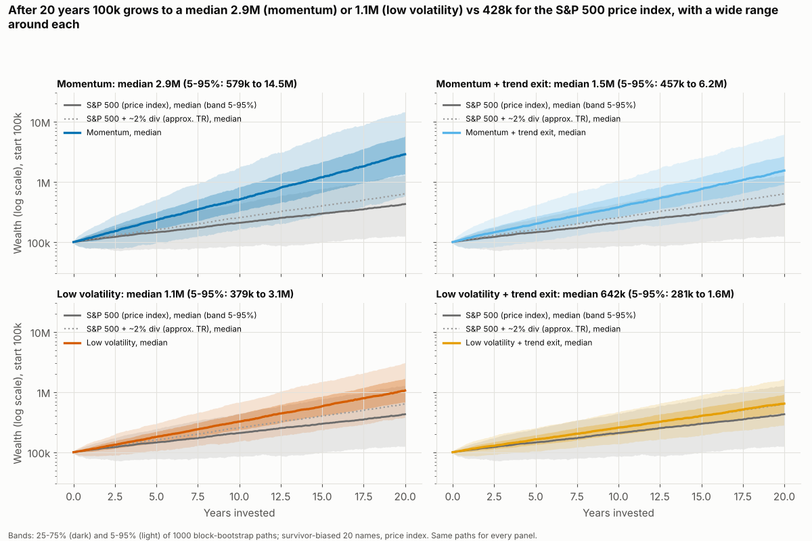
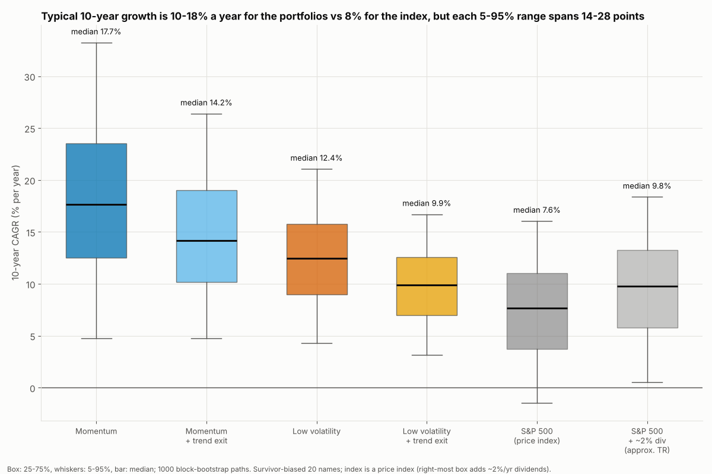
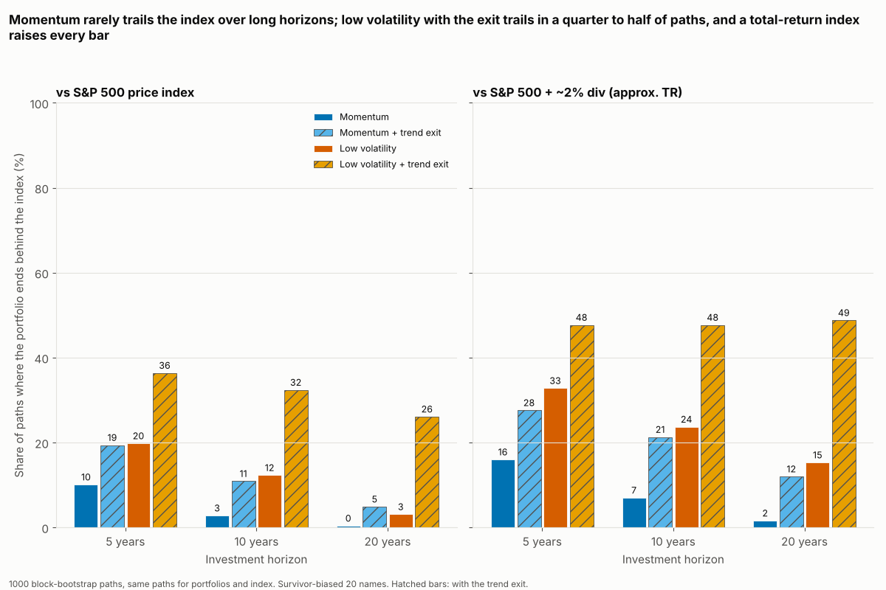
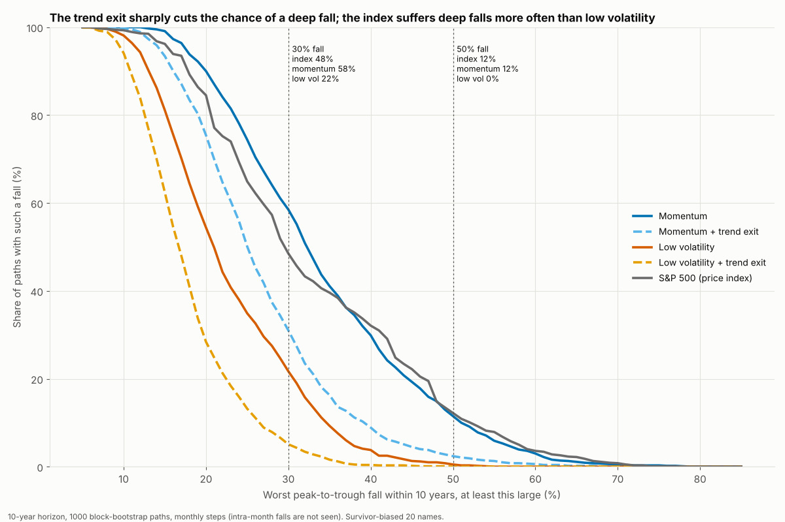

# How wide is the range of outcomes? A Monte Carlo study on S&P 500 data

*Data: 20 large S&P 500 stocks plus the S&P 500 index, 1990-2022 (bundled with the package). Script: `research/montecarlo_sp500.py` (about a minute, fixed seeds). Tables: `research/montecarlo/*.csv` (regenerated by the script, not tracked in git).*

## Bottom line

* **In this data the stock-picking portfolios beat the S&P 500 price index in most simulated futures, but the edge is about the size of the data's survivorship bias, so do not read it as skill or as a forecast.** Momentum's median 10-year growth is 17.7% a year against 7.6% for the index, and it trails the index in only 3% of 10-year paths. But the 20 stocks are survivors picked with hindsight: an equal-weight basket of them beat the index by 10 percentage points a year, and the portfolios' median edge over the index here is 10% (momentum) and 5% (low volatility). The data cannot tell skill from that bias.
* **The range of outcomes is wide even in this friendly setting.** A 10-year investor in the momentum portfolio ends between 159k (5th percentile) and 1.76M (95th) from 100k; the median is 509k. In 58% of those paths there is a fall of more than 30% on the way, and in 12% a fall of more than 50% (month-end data, so real intra-month falls are deeper).
* **The price-index benchmark flatters the portfolios.** Adding roughly 2% a year of dividends to the index (an approximation, not a real total-return series) raises the chance of trailing it at 10 years from 3% to 7% (momentum), 12% to 24% (low volatility) and 32% to 48% (low volatility with the exit).
* **The fixed trend exit trades return for protection, and the trade is not free.** It cuts the chance of a fall deeper than 30% over 10 years from 58% to 31% for momentum and from 22% to 5% for low volatility, but lowers the median 10-year growth by 3.5 and 2.5 points a year. Low volatility with the exit ends level with the approximate total-return index about half the time (it trails it in 48% of 10-year paths).
* **The answer does not hinge on the resampling method.** Four generators (12-month blocks, random-length blocks, volatility regimes, single months) give the same ordering of portfolios and similar numbers (sensitivity table below).

## Two warnings that apply to everything below

1. **Survivor-biased stocks.** The 20 names are today's large, successful companies that were already listed in 1990. Companies that failed or shrank are missing. The package's survivorship score for this data is **+10.1 percentage points a year**: an equal-weight basket of the 20 names beat the S&P 500 by that much. Resampling cannot remove this; every simulated path inherits it. Treat the portfolios' results as an upper bound on what picking from the full market would have delivered.
2. **A price index as the yardstick.** The `SP500` series leaves dividends out, while the portfolios use adjusted prices that include them. Against the plain index the portfolios look better than they should, by about the index's dividend yield. We therefore show every comparison twice: against the index as it is (the Lab refuses a price-index benchmark unless told `allow_price_benchmark=True`, which this study does on purpose), and against **"SP500 + ~2% div (approx. TR)"**, which adds 2% a year to the index on every path (the same approximation as `IndexBenchmark("SP500", dividend_yield=0.02)`). The 2% is a rough long-run dividend yield, not data.

The software prints the same two warnings on every result (`str(result)`), together with the note that bootstrap paths inherit the data's biases.

## What we did, in plain words

1. **The history.** Monthly closing prices of 20 stocks and the S&P 500 index from 1990-01 to 2022-12 (33 years, 395 monthly returns).
2. **Making 1,000 alternative futures.** We build each future by cutting the history into 12-month blocks (a "block bootstrap"), drawing blocks at random and gluing them together. Within a block all 20 stocks and the index keep their real joint moves, so crashes hit everything together, as they do in reality. Each future is 21 years long: the first year is a warm-up (the strategies need 12 months of history to rank stocks), and then 5, 10 or 20 years are measured. All portfolios and the index see exactly the same 1,000 futures, so the comparison is like for like.
3. **The portfolios.** Each month the portfolio holds the 5 stocks with the best 12-month-minus-1-month price momentum (**Momentum**) or the 5 least volatile over the past year (**Low volatility**), equal weight, rebalanced monthly, paying 25 basis points (0.25%) on every unit traded. "+ trend exit" adds the fixed rule written down in advance in `CALIBRATION_SP500.md`: leave for cash when the S&P 500 is weak against its own 10-month average (score threshold 0.8, hysteresis 0.1, weekly check, 10-day minimum hold, 5 basis points per switch) and return when the signal clears. The rule was never tuned on this data. Because the paths are monthly, the rule is checked once a month rather than weekly.
4. **The numbers.** For every future we measure terminal wealth from 100,000, compound annual growth (CAGR), the worst peak-to-trough fall and the time to recover from it, then read off percentiles across the 1,000 futures.
5. **Sensitivity.** We repeat the 10-year summary with three other ways of making futures: random-length blocks averaging 12 months (stationary bootstrap), blocks drawn from calm or stormy volatility periods (regime bootstrap), and single months drawn independently (no memory at all).

## Results

**Main table.** 12-month block bootstrap, 1,000 paths. "P(trail ...)" is the share of paths in which the portfolio ends the horizon behind the index on the same path. CAGR here is the portfolio's own growth with no deposits or withdrawals.

| Portfolio | Median 10y CAGR | 5-95% range of 10y CAGR | P(trail price idx) 5y | P(trail price idx) 10y | P(trail price idx) 20y | P(trail approx-TR idx) 5y | P(trail approx-TR idx) 10y | P(trail approx-TR idx) 20y | P(MaxDD worse than -30%) 10y |
|---|---:|---:|---:|---:|---:|---:|---:|---:|---:|
| Momentum | 17.7% | 4.8% to 33.2% | 10% | 3% | 0% | 16% | 7% | 2% | 58% |
| Momentum + trend exit | 14.2% | 4.7% to 26.4% | 19% | 11% | 5% | 28% | 21% | 12% | 31% |
| Low volatility | 12.4% | 4.3% to 21.1% | 20% | 12% | 3% | 33% | 24% | 15% | 22% |
| Low volatility + trend exit | 9.9% | 3.2% to 16.7% | 36% | 32% | 26% | 48% | 48% | 49% | 5% |
| S&P 500 (price index) | 7.6% | -1.4% to 16.1% | - | - | - | - | - | - | 48% |
| S&P 500 + ~2% div (approx. TR) | 9.8% | 0.5% to 18.4% | - | - | - | - | - | - | 48% |

**Terminal wealth** from 100,000 (percentiles across paths):

| Portfolio | Years | 5th pct | 25th | Median | 75th | 95th |
|---|---:|---:|---:|---:|---:|---:|
| Momentum | 10 | 159k | 325k | 509k | 828k | 1.76M |
| Momentum | 20 | 579k | 1.35M | 2.87M | 5.77M | 14.52M |
| Momentum + trend exit | 10 | 159k | 264k | 376k | 571k | 1.04M |
| Momentum + trend exit | 20 | 457k | 909k | 1.54M | 2.66M | 6.22M |
| Low volatility | 10 | 152k | 236k | 323k | 433k | 676k |
| Low volatility | 20 | 379k | 683k | 1.06M | 1.67M | 3.07M |
| Low volatility + trend exit | 10 | 137k | 197k | 257k | 326k | 469k |
| Low volatility + trend exit | 20 | 281k | 453k | 642k | 921k | 1.64M |
| S&P 500 (price index) | 10 | 86k | 144k | 209k | 285k | 443k |
| S&P 500 (price index) | 20 | 125k | 266k | 428k | 671k | 1.27M |

**Falls and recovery over 10 years** (worst peak-to-trough fall on each path, month-end data):

| Portfolio | P(fall worse than 30%) | P(fall worse than 50%) | Median years to recover | P(not recovered by year 10) |
|---|---:|---:|---:|---:|
| Momentum | 58% | 12% | 1.5 | 23% |
| Momentum + trend exit | 31% | 2% | 1.2 | 20% |
| Low volatility | 22% | 0% | 1.1 | 16% |
| Low volatility + trend exit | 5% | 0% | 1.1 | 17% |
| S&P 500 (price index) | 48% | 12% | 2.6 | 34% |

**Sensitivity to the way futures are generated** (10-year horizon, 1,000 paths each; the block-bootstrap rows are the main run, with different random draws from the other three, so differences of 1-3 points are noise). Median 10-year CAGR of the price index: BlockBootstrap(12) 7.6%, StationaryBootstrap(12) 8.5%, RegimeBootstrap (volatility) 7.8%, IIDBootstrap 7.7%.

| Generator | Portfolio | Median 10y CAGR | P(trail price idx) 10y | P(trail approx-TR idx) 10y |
|---|---:|---:|---:|---:|
| BlockBootstrap(12) | Momentum | 17.7% | 3% | 7% |
| BlockBootstrap(12) | Momentum + trend exit | 14.2% | 11% | 21% |
| BlockBootstrap(12) | Low volatility | 12.4% | 12% | 24% |
| BlockBootstrap(12) | Low volatility + trend exit | 9.9% | 32% | 48% |
| StationaryBootstrap(12) | Momentum | 19.9% | 2% | 6% |
| StationaryBootstrap(12) | Momentum + trend exit | 16.1% | 9% | 15% |
| StationaryBootstrap(12) | Low volatility | 13.1% | 10% | 24% |
| StationaryBootstrap(12) | Low volatility + trend exit | 10.0% | 33% | 47% |
| RegimeBootstrap (volatility) | Momentum | 17.6% | 4% | 9% |
| RegimeBootstrap (volatility) | Momentum + trend exit | 13.7% | 15% | 25% |
| RegimeBootstrap (volatility) | Low volatility | 12.7% | 10% | 24% |
| RegimeBootstrap (volatility) | Low volatility + trend exit | 9.8% | 33% | 51% |
| IIDBootstrap | Momentum | 18.2% | 4% | 9% |
| IIDBootstrap | Momentum + trend exit | 13.9% | 15% | 26% |
| IIDBootstrap | Low volatility | 12.9% | 8% | 24% |
| IIDBootstrap | Low volatility + trend exit | 10.0% | 31% | 51% |

## Charts

## What these numbers can and cannot support

**They can support:**
* The *width* of outcomes: even a portfolio that beats the index on average has bad paths (5th-percentile 10-year growth is only 3% to 5% a year across the four portfolios), and a fall deeper than 30% in roughly one path in five (low volatility) to six in ten (momentum) over 10 years.
* The *relative* picture: low volatility has shallower falls and a narrower range than momentum; the trend exit shortens and shallows falls at the cost of return; and any claim of "beats the index" depends heavily on which index (price or total return) is used.
* The statement that, conditional on this history repeating its building blocks, a 10-year horizon is far from enough to be sure of anything about the index gap for the weaker portfolios.

**They cannot support:**
* A forecast. All futures are rearrangements of the same 33 years (395 monthly returns). The 1,000 paths look like a lot, but they carry no more information than the one history they are drawn from: a crisis that is not in 1990-2022, or a decade of a very different regime, cannot appear. Block bootstrap also cuts the history at block edges, so dependence longer than a year is lost.
* The size of any edge. Survivorship (+10 points a year) is of the same size as the momentum "edge" over the index; the true edge from this kind of selection in the full market is likely much smaller, and may be zero or negative.
* Real-world costs and taxes beyond the 25 and 5 basis points modelled, the 2% dividend yield as a precise number, intra-month falls (month-end data understates them), or the exit's behaviour with daily/weekly timing.
* Probabilities to the percentage point. With 1,000 paths a probability near 50% has a sampling error of about 1.5 points, and the paths share much of their content, so the real uncertainty is larger.

## Reproduce

    python -m screenlab.research.montecarlo_sp500      # from the directory that contains screenlab/

Seed 20240, 1000 paths, month-end steps, 25 bps one-way costs. Runtime about a minute. The operation behind it is `Lab.montecarlo` (see `docs/REFERENCE.md`).
