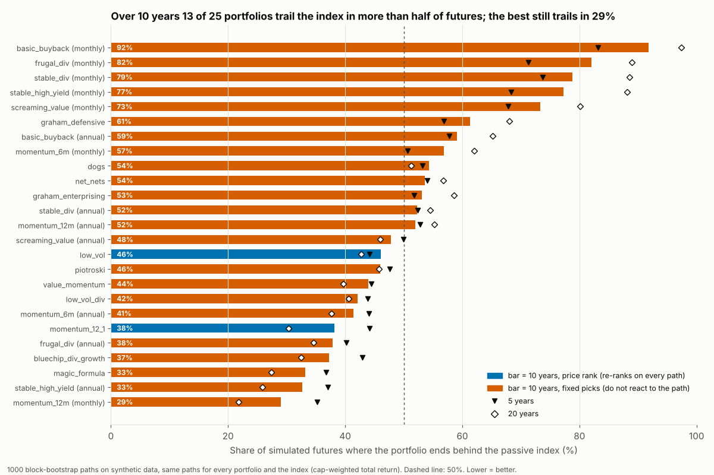
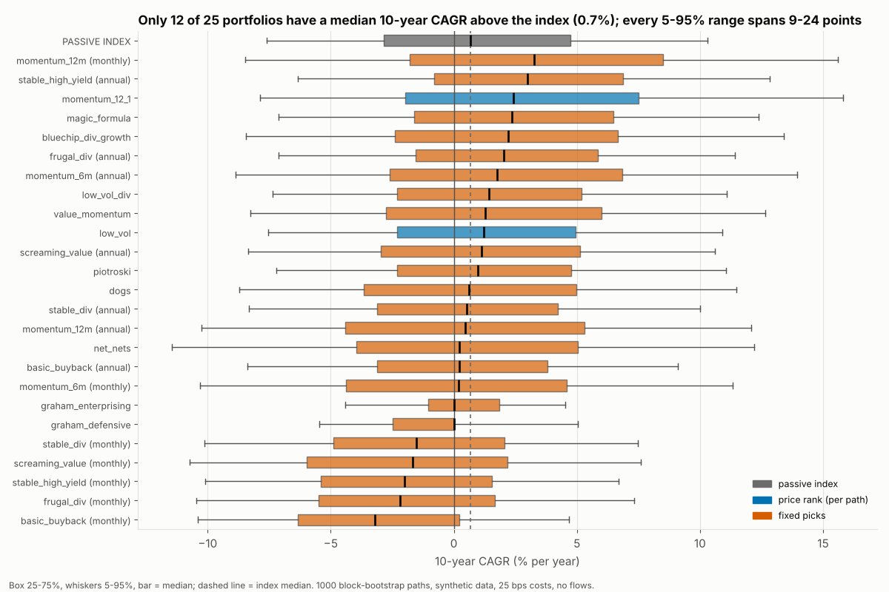
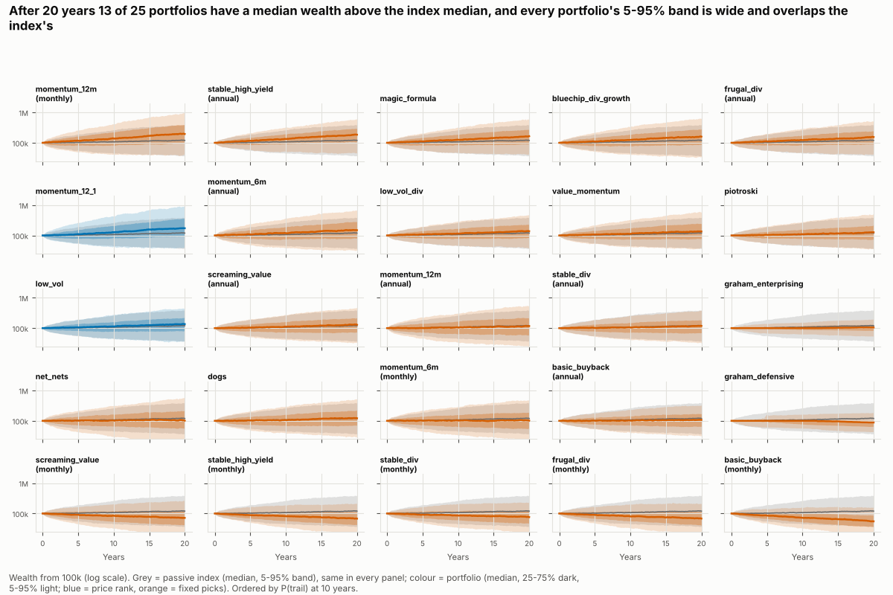
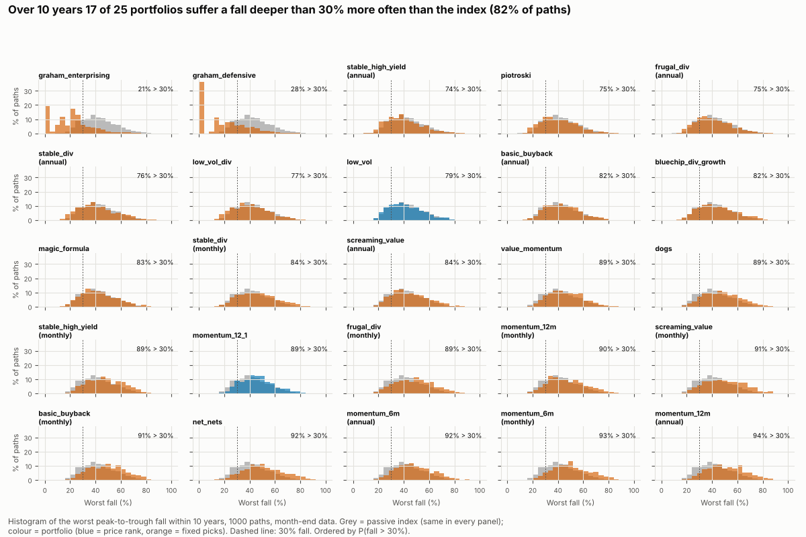

# Monte Carlo for every portfolio: how often does each screen trail the index?

*Data: synthetic, 2000-01-03..2024-02-23, 250 names, benchmark SYN_CAPWT (total_return), PIT yes, delisted yes (51), survivorship +1.6%/yr. Script: `research/montecarlo_all.py` (seed 20241, 1000 paths, 4 minutes). Tables: `research/montecarlo_all/*.csv` (regenerated by the script, not tracked in git).*

## Bottom line

* **13 of 25 portfolios trail the passive index in more than half of 10-year futures; 12 of 25 have a median 10-year CAGR above the index's 0.7%.** The best, `momentum_12m (monthly)`, trails in 29% of 10-year futures; the worst, `basic_buyback (monthly)`, in 92%.
* **No flattering here, by construction.** The data is synthetic: the prices are generated, so there are no hindsight-picked survivors. The package's survivorship score is +1.6 points a year (an equal-weight basket of the universe against the index; small, and the data keeps its delisted names), and the benchmark is a total-return index, so the dividend gap that flattered the S&P 500 study is absent. What you see is the screen against the market, after 25 bps of costs.
* **The range of outcomes is wide for everything, the index included.** The 5-95% range of 10-year growth is -8% to 10% a year for the index, and a fall deeper than 30% occurs in 82% of its 10-year paths (this synthetic market is a rough one: the index's median 10-year CAGR is only 0.7%). 17 of 25 portfolios suffer such a fall more often than the index.
* **Rebalancing monthly instead of annually raises P(trail) at 10 years for 6 of 7 screens** (same screen, same paths; mean 70% vs 46%): the extra turnover costs more than it earns here.
* **A longer horizon helps 13 of 25 portfolios**: their chance of trailing is lower at 20 years than at 5. For the others the gap, if anything, widens with time.
* **Price-rank screens (re-ranked on every path) and fixed-pick screens differ**: median P(trail) at 10 years is 42% for the 2 price-rank portfolios and 52% for the 23 fixed-pick ones. Read this with the caveat below.

## Method in plain words

1. **The history.** A synthetic market of 250 stocks, daily, 2000-2024, with accounting data (earnings, book value, dividends, ...) available as of each date, and a cap-weighted total-return index. It is cut to month-end prices.
2. **1000 alternative futures.** Cut the history into 12-month blocks (block bootstrap), draw blocks at random and glue them into 22-year paths. Within a block every stock, the index and the accounting data keep their real joint dates, so crashes hit everything together. The first year of each path is a warm-up; then 5, 10 and 20 years are measured. Every portfolio and the index see exactly the same futures.
3. **The portfolios.** Every screen in the registry at a 12-month rebalance, plus the seven monthly Globe portfolios at their published monthly rebalance (marked `(monthly)`; the 12-month run of the same screen is marked `(annual)`), plus two price-only ranks added for the per-path mode (`momentum_12_1`, `low_vol`, 10 names). Equal weight, 25 bps one-way trading cost. The Globe portfolio `bluechip_dividend_growth` is annual in the registry run; its published hold rule (keep a holding while it ranks in the top 2n) cannot run in fixed mode, so it appears once, without the hold rule.
4. **The numbers.** For each future: terminal wealth from 100,000, CAGR, the worst fall, and whether the portfolio ended behind the index; percentiles over the 1000 futures.

## The one caveat that matters: fixed-mode picks

Only the 2 plain price-rank portfolios (`momentum_12_1`, `low_vol`) can be re-run on each simulated future's own prices (**per_path**). The other 23 of 25 use accounting data (earnings, book value, dividends) or a size cut, which the bootstrap does not re-create; this includes the registry's `momentum_6m` and `momentum_12m`, which are multi-stage screens (top 300 by size, then rank). For these the package decides the picks **once, on the real (synthetic) history, at each date, and carries them along when the date is reused in a simulated future (fixed mode)**. In plain words: **a fixed-mode portfolio does not react to what happens on the simulated path.** It holds the names the screen would have chosen at the matching date of the original history, whatever those names did in the new future. The result shows how those historical picks fare when their returns are rearranged, not how the screen would behave in a different world. Fixed-mode and per-path numbers are therefore not strictly like for like, and the fixed-mode ones understate how much a real screen's picks would change from future to future. The selection mode is recorded per portfolio in the result and in the table below.

## Results

**Main table** (ranked by the chance of trailing the index at 10 years; lower is better). P(trail) = share of futures where the portfolio ends the horizon behind the index on the same future. CAGR is the portfolio's own growth with no deposits or withdrawals.

| Portfolio | Mode | Median 10y CAGR | 5-95% of 10y CAGR | P(trail) 5y | P(trail) 10y | P(trail) 20y | P(fall>30%) 10y |
|---|---:|---:|---:|---:|---:|---:|---:|
| momentum_12m (monthly) | fixed | 3.3% | -8% to 16% | 35% | 29% | 22% | 90% |
| stable_high_yield (annual) | fixed | 3.0% | -6% to 13% | 37% | 33% | 26% | 74% |
| magic_formula | fixed | 2.4% | -7% to 12% | 37% | 33% | 27% | 83% |
| bluechip_dividend_growth | fixed | 2.2% | -8% to 13% | 43% | 37% | 32% | 82% |
| frugal_dividend (annual) | fixed | 2.0% | -7% to 11% | 40% | 38% | 35% | 75% |
| momentum_12_1 | per_path | 2.4% | -8% to 16% | 44% | 38% | 30% | 89% |
| momentum_6m (annual) | fixed | 1.8% | -9% to 14% | 44% | 41% | 38% | 92% |
| low_vol_dividend | fixed | 1.4% | -7% to 11% | 44% | 42% | 41% | 77% |
| value_momentum | fixed | 1.3% | -8% to 13% | 44% | 44% | 40% | 89% |
| piotroski | fixed | 1.0% | -7% to 11% | 48% | 46% | 46% | 75% |
| low_vol | per_path | 1.2% | -8% to 11% | 44% | 46% | 43% | 79% |
| screaming_value (annual) | fixed | 1.1% | -8% to 11% | 50% | 48% | 46% | 84% |
| momentum_12m (annual) | fixed | 0.5% | -10% to 12% | 53% | 52% | 55% | 94% |
| stable_dividend (annual) | fixed | 0.5% | -8% to 10% | 52% | 52% | 55% | 76% |
| graham_enterprising | fixed | 0.0% | -4% to 5% | 52% | 53% | 59% | 21% |
| net_nets | fixed | 0.2% | -11% to 12% | 54% | 54% | 57% | 92% |
| dogs | fixed | 0.6% | -9% to 11% | 53% | 54% | 51% | 89% |
| momentum_6m (monthly) | fixed | 0.2% | -10% to 11% | 51% | 57% | 62% | 93% |
| basic_buyback (annual) | fixed | 0.2% | -8% to 9% | 58% | 59% | 65% | 82% |
| graham_defensive | fixed | 0.0% | -5% to 5% | 57% | 61% | 68% | 28% |
| screaming_value (monthly) | fixed | -1.7% | -11% to 8% | 68% | 73% | 80% | 91% |
| stable_high_yield (monthly) | fixed | -2.0% | -10% to 7% | 68% | 77% | 88% | 89% |
| stable_dividend (monthly) | fixed | -1.5% | -10% to 7% | 74% | 79% | 88% | 84% |
| frugal_dividend (monthly) | fixed | -2.2% | -10% to 7% | 71% | 82% | 89% | 89% |
| basic_buyback (monthly) | fixed | -3.2% | -10% to 5% | 83% | 92% | 97% | 91% |
| SYN_CAPWT (passive) | - | 0.7% | -8% to 10% | - | - | - | 82% |

## Charts

## What holds and what does not

**Holds, on this data:**
* The ordering of portfolios by the chance of trailing the index and by the width of outcomes. It survives a change of path draw because every portfolio sees the same paths.
* The statement that, after realistic costs and without survivorship, trailing the index is the common outcome for most of these rules over 5-20 years, and that no portfolio is safe from a 30% fall.
* The comparison of one portfolio's annual version with its monthly version (same screen, same paths): the difference is the rebalance frequency and its costs.

**Does not hold, or not proven:**
* A forecast. All futures are rearrangements of 24 years of one synthetic history; a regime absent from it cannot appear.
* Real-world edge. The synthetic market was generated with its own return rules, which is why results here can differ from the S&P 500 study; neither tells you what the screens do in the real full market.
* Fixed-mode results as behaviour. See the caveat above: those picks are history's, not the path's.
* The two Graham portfolios: their growth near 0% and shallow falls look like a mostly-in-cash portfolio (few names pass the tests in this data), which is not evidence of safety or of skill.
* Probabilities to the percentage point: with 1000 paths a probability near 50% carries about 1.5 points of sampling error, more because paths share content.

## Reproduce

    python -m screenlab.research.montecarlo_all      # from the directory that contains screenlab/

The operation is `Lab.montecarlo(..., selection="auto")` (see `docs/REFERENCE.md`).
